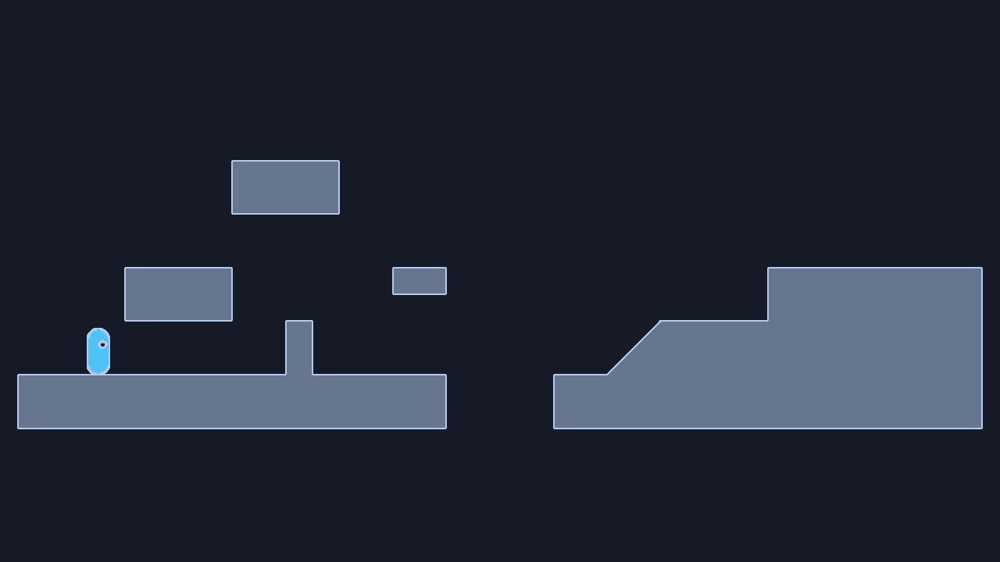

# 2D 平台跳跃模板（Unity 2022.3.61f1c1 / URP 2D）

一个可直接运行、方便二次修改的 2D 平台跳跃最小模板。

地形采用 **2 格为单位的模块化构件**（2×2 方块、2×1 与 1×2 长方体），**1 格**作为精细搭建的基础单位。地面、墙、台阶、平台**全部使用同一种颜色**，配合全屏描边，任意相邻地形都会自动合并成一条外轮廓。




## 已实测验证（PlayMode 自动化测试 6/6 通过）

| 测试 | 结果 |
|---|---|
| 跳跃高度 | **5.999 格**（目标 6 格，误差 +0.001） |
| 相机跟随误差 | **0.000** 单位（1.5 秒内收敛） |
| 45° 斜坡爬升 | 成功（从 y=0.85 沿坡爬到峰值 y=2.77，即坡顶） |
| 水平移动、站立检测、坠落重生 | 通过 |

## 地形构件

| 精灵 | 尺寸 | 用途 |
|---|---|---|
| `block2x2.png` | 2×2 格（64×64 px） | 地面、台阶、平台等主体 |
| `block2x1.png` | 2×1 格（64×32 px） | 薄板、悬挑等横向细节 |
| `block1x2.png` | 1×2 格（32×64 px） | 立柱、窄墙等纵向细节 |
| `slope2x2.png` | 2×2 格，45° 三角 | 斜坡 |

全部是纯白精灵，由 `SpriteRenderer.color` 统一上色（默认统一地形色 `#66758F`），所以**地板和墙没有颜色/类型区分**。

## 合并描边（Screen Outline）

描边不再逐块绘制，而是由 **URP 2D Renderer Feature** 在全屏最后阶段统一处理：

- `Assets/Scripts/Rendering/ScreenOutlineFeature.cs` + `Assets/Shaders/ScreenOutline.shader`
- 检测画面中的**颜色突变**，在其上叠加描边色
- 同色、紧挨着的地形内部没有颜色突变 → **不会有内部线条**，整片地形只显示一条外轮廓
- 任何形状、任何尺寸都自动合并（包括斜坡与台阶的斜边衔接）
- 角色也会被同一套描边勾勒

可调项：

| 内容 | 位置 |
|---|---|
| 描边颜色 | `Assets/Materials/ScreenOutline.mat` → Outline Color |
| 描边宽度（像素） | `ScreenOutline.mat` → Width（默认 **1px**），或 `ScreenOutlineFeature.asset` → Width Pixels |
| 边缘灵敏度 | `_Threshold`（默认 0.06） |
| 地形颜色 | 场景中各地形实例的 SpriteRenderer Color（构建脚本里是 `TerrainColor`） |
| 插入时机 | `ScreenOutlineFeature.asset` → Injection Point |

> 描边是屏幕空间效果，粗细以像素计，不随镜头缩放变化。

## 开发文档

完整的开发历程、架构说明、关键设计与已知限制见 **[docs/DEVELOPMENT.md](docs/DEVELOPMENT.md)**。

## 打开方式

1. Unity Hub → Open → 选择本目录（`unity2Dcsm`）
2. 用 **Unity 2022.3.61f1c1** 打开
3. 打开场景 `Assets/Scenes/Level01.unity`（或菜单 `Platformer > Open Level 01`）
4. 点 Play

## 操作

| 操作 | 按键 |
|---|---|
| 左右移动 | `A` / `D` 或 `←` / `→` |
| 跳跃 | `空格`（按住跳更高，松开立刻截断上升） |

## 关卡内容

- 地面为 **2 格厚**的整块板，中间有 **4 格宽的坑**
- 一块 **2×2 格、45° 斜坡**，接上 2 格高的台阶
- 台阶每级固定 **2 格高**（2 格 → 4 格）
- 两块 2×2 悬浮平台（分别在 4 格、8 格高度）
- 细节演示：2×1 薄板 + 1×2 立柱
- 主角是 **1.7 格高的胶囊体**，最大跳跃高度 **6 格**
- 相机平滑跟随，带移动方向前瞻

## 数值设计

- 1 格 = 1 世界单位，占位图 PPU = 32（32px = 1 格）
- 重力 `Physics2D.gravity.y = -40`（见 `ProjectSettings/Physics2DSettings.asset` 或构建脚本）
- 跳跃初速度由公式 `v = √(2·g·h)` 在起跳瞬间计算，并加半帧重力补偿
  → **改重力不会改变跳跃高度**，改 `jumpHeight` 才会

## 可调参数（Player 预制体 / 场景中的 Player）

| 字段 | 默认值 | 说明 |
|---|---|---|
| `jumpHeight` | 6 | 最大跳跃高度（格） |
| `playerHeight` | 1.7 | 角色高度（格），用于地面检测与 Gizmo |
| `moveSpeed` | 7 | 最大水平速度 |
| `groundAcceleration` / `groundDeceleration` | 90 / 120 | 地面加减速 |
| `airAcceleration` / `airDeceleration` | 55 / 35 | 空中加减速 |
| `coyoteTime` | 0.1 | 离开平台后的宽容起跳时间 |
| `jumpBufferTime` | 0.12 | 落地前预输入跳跃 |
| `fallGravityMultiplier` | 1.6 | 下落额外重力，手感更干脆 |
| `jumpCutMultiplier` | 0.45 | 松开跳跃键时保留的上升速度 |
| `groundMask` | Ground 层 | 哪些层算地面 |

相机：`Main Camera` 上的 `CameraFollow2D`（`smoothTime`、`offset`、`lookAheadDistance` 可调）。

## 目录结构

```
Assets/
  Art/Placeholders/     block2x2.png / block2x1.png / block1x2.png / slope2x2.png / player_capsule.png
  Editor/               ProjectBuilder.cs（一键重建关卡与预制体）
  Materials/            ScreenOutline.mat
  Prefabs/              Player / Block2x2 / Block2x1 / Block1x2 / Slope2x2
  Scenes/Level01.unity  主场景
  Scripts/
    PlayerController2D.cs
    CameraFollow2D.cs
    Rendering/ScreenOutlineFeature.cs
  Shaders/              ScreenOutline.shader
  Settings/             URP 管线资源 + ScreenOutlineFeature.asset
  Tests/PlayMode/       角色物理与相机跟随的自动化测试
Tools/generate_placeholders.py   占位图生成脚本
```

## 重建关卡

改了关卡布局或占位图后，执行菜单：

```
Platformer > Rebuild Level + Prefabs
```

或命令行：

```
Unity.exe -batchmode -projectPath <项目路径> -executeMethod Platformer.EditorTools.ProjectBuilder.BuildAll -quit
```

## 运行自动化测试

Unity 菜单 `Window > General > Test Runner` → PlayMode → Run All。

命令行：

```
Unity.exe -batchmode -projectPath <项目路径> -runTests -testPlatform PlayMode -testResults TestResults.xml -logFile Logs/playtests.log
```

测试覆盖：站立检测、6 格跳高、水平移动、相机跟随、坠落重生、45° 斜坡爬坡。

## 后续可扩展

- 替换 `Assets/Art/Placeholders` 里的图片并在 Prefab 上重新指定 Sprite
- 用 Tilemap（项目已含 `com.unity.2d.tilemap`）替代逐块摆放
- 加 Animator 做跑步/跳跃动画
- 加 `PhysicsMaterial2D` 调整摩擦，或做墙跳、冲刺、可破坏方块
- 相机可加 `Cinemachine` 做更复杂的运镜
