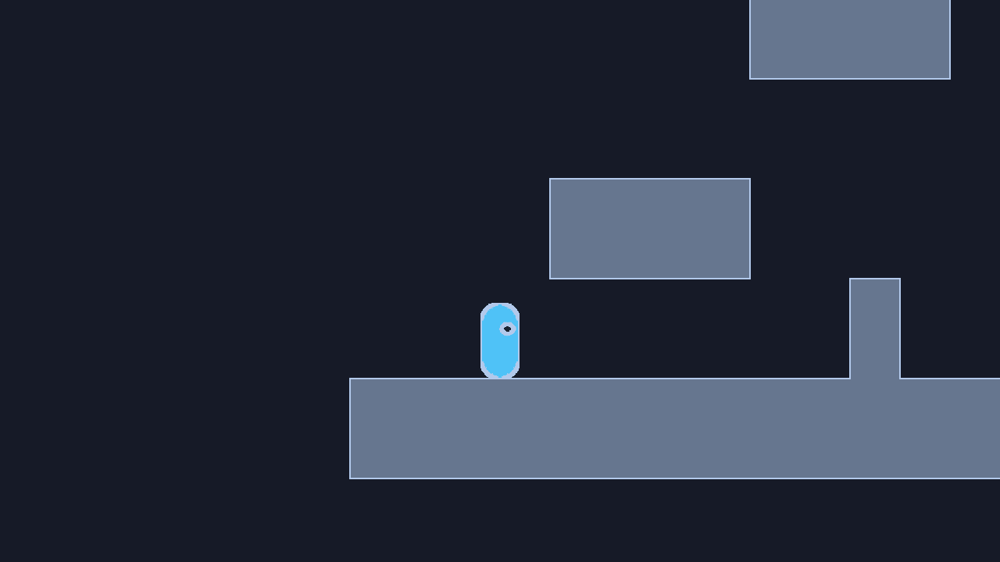

# 2D 平台跳跃模板（Unity 2022.3.61f1c1 / URP 2D）

一个可直接运行、方便二次修改的 2D 平台跳跃最小模板。

地图由 **Tilemap** 构建：一个 Grid、一个 Tilemap、一套合并碰撞体，**全部以 1×1 瓦片为单位**逐格绘制。地面、墙、台阶、平台**全部同一种颜色**，配合全屏描边，任意相邻地形都会自动合并成一条外轮廓。




## 已实测验证（PlayMode 自动化测试 9/9 通过）

| 测试 | 结果 |
|---|---|
| 跳跃高度 | **5.999 格**（目标 6 格，误差 +0.001） |
| 相机跟随误差 | **0.000** 单位（1.5 秒内收敛） |
| 45° 斜坡爬升 | 成功（峰值 2.76） |
| Tilemap 关卡集成 | 通过（135 格瓦片，玩家站立在合并碰撞体上，y=0.75） |
| 瓦片斜坡爬升 | 通过（玩家沿 1×1 斜坡瓦片走上 2 格高台） |
| 相机快照 | 通过（捕获范围 = 主相机视野 1.2 倍，图像包含场景内容） |
| 水平移动、站立检测、坠落重生 | 通过 |

## 地图构建方式

| 资产 | 说明 |
|---|---|
| `Assets/Tiles/TerrainTile.asset` | 普通地形瓦片（`#E0E0E0` 超浅灰），1×1 |
| `Assets/Tiles/DarkTerrainTile.asset` | 深灰瓦片（`#454C5C`），与普通瓦片不融合、深灰之间融合 |
| `Assets/Tiles/SlopeUpRight / UpLeft / DownRight / DownLeft` | 1×1 的 45° 斜坡瓦片，4 个方向，普通色 |
| `Assets/Tiles/Slope*Dark` | 同上 4 个方向的深灰版本 |

共 **10 个 Tile 资产**：2 个方块 × 2 种颜色 + 4 个方向 × 2 种颜色。

场景层级：

```
Level
├── Grid
│   └── Terrain      Tilemap + TilemapRenderer + TilemapCollider2D
│                    + CompositeCollider2D + Rigidbody2D(Static)
├── Player
├── Main Camera
└── Global Light 2D
```

- 栅格：统一 **1×1 瓦片**，逐格绘制（不再有 2×2 / 2×1 / 1×2 的方块尺寸变体）
- 碰撞：`TilemapCollider2D`（`Used By Composite`）+ `CompositeCollider2D`，整张地形合并成**一个多边形碰撞体**，不会卡在瓦片接缝上
- 斜坡瓦片使用**精确三角形物理形状**（由导入脚本写入 Sprite 的 Custom Physics Shape），碰撞面与视觉完全重合
- 物理材质：TilemapCollider2D 与 CompositeCollider2D 都使用 `TerrainPhysicsMaterial`
- 所有瓦片共用一张 32×32 的纯白贴图，颜色由 Tile 资产决定

### 手动绘制地图

调色板已经准备好了：`Assets/Palettes/TerrainPalette.prefab`，包含全部 10 个瓦片。

1. 菜单 `Window > 2D > Tile Palette` 打开调色板窗口
2. 在窗口左上角的下拉框里选择 **TerrainPalette**
3. 选中场景中的 `Grid/Terrain` 对象，用画笔 / 矩形工具逐格绘制；斜坡瓦片有 4 个方向，可直接拼任意坡道

## 描边系统

描边分两层：**每个瓦片自带的内描边** + **全屏合并的外轮廓**。

### 1. 瓦片内描边（烘焙在贴图里）

- 瓦片贴图本身带一圈 1px 的边，颜色是满亮度的 **0.929 倍**
- Tile 颜色和贴图相乘，所以每个瓦片的边自动等于它自己的颜色降一档：
  `#E0E0E0 → #D0D0D0`、`#454C5C → #404750`
- 因此每个方块都有独立的边，连成一片时也能看清每格
- 想调暗边强度，改 `Tools/generate_placeholders.py` 里的 `RIM`（237/255 ≈ 0.929）

### 2. 全屏合并外轮廓（Screen Outline）

由 **URP 2D Renderer Feature** 在全屏最后阶段统一处理：

- `Assets/Scripts/Rendering/ScreenOutlineFeature.cs` + `Assets/Shaders/ScreenOutline.shader`
- **轮廓边**：与相机背景色比较判断“内外”，在形状内侧 1px、外侧 1px 画描边。用二值判断而不是直接比色差，斜边（45°）也能得到连续、不闪烁的单像素线
- **类型边界**：普通 / 深灰地形之间颜色不同 → 画分界线，两种颜色不会融合
- 同色地形内部只有瓦片自身的暗边，不会被外轮廓重复描一次（阈值 0.28 高于内描边的色差）
- 角色也会被同一套描边勾勒

可调项：

| 内容 | 位置 |
|---|---|
| 外轮廓颜色 | `Assets/Materials/ScreenOutline.mat` → Outline Color |
| 外轮廓宽度（像素） | `ScreenOutline.mat` → Width（默认 **1px**），或 `ScreenOutlineFeature.asset` → Width Pixels |
| 类型边界灵敏度 | `_Threshold`（默认 **0.28**，需高于瓦片内描边的色差） |
| 背景判定容差 | `ScreenOutlineFeature` 里的 `_BackgroundTolerance`（默认 0.05，背景不是纯色时需调大或关闭轮廓项） |
| 瓦片内描边强度 | `Tools/generate_placeholders.py` → `RIM` |
| 地形颜色 | `Assets/Tiles/TerrainTile.asset` / `DarkTerrainTile.asset` → Color |
| 插入时机 | `ScreenOutlineFeature.asset` → Injection Point |

> 外轮廓是屏幕空间效果，粗细以像素计，不随镜头缩放变化；瓦片内描边是贴图效果，随镜头缩放。
> 轮廓边依赖相机的纯色背景（Solid Color），如果以后换成 Skybox / 图片背景，需要相应调整判定方式。

## 相机快照（Snapshot Camera）

场景里有一套“相机拍摄 → 图像精灵”的捕获系统：

```
Snapshot Camera（正交，orthoSize = 主相机 × 1.2）
    → RenderTexture 960×540
    → Texture2D.ReadPixels
    → Sprite（PPU 按捕获世界高度换算）
    → Snapshot Output 的 SpriteRenderer
```

| 项目 | 说明 |
|---|---|
| 捕获范围 | 主相机视野的 **1.2 倍**（`RegionSnapshotCamera.viewScale`） |
| 捕获相机 | `Snapshot Camera`，位置跟随主相机，按需渲染（`enabled = false`） |
| 刷新间隔 | `captureInterval` 默认 **0.05 秒**（0 = 每帧） |
| 输出 | `Snapshot Output`（`Snapshot` 层 8），默认显示缩放 0.5 |
| 防穿帮 | 捕获相机的 cullingMask 排除 `Snapshot` 层，不会拍到自己的输出 |
| 无头模式 | 没有图形设备时自动禁用，避免 `Camera.Render()` 在 `-nographics` 下卡死 |

> 输出的是**真实图像**（Texture2D），不是对象复制；上面的字母/像素会被一并拍下。
> 预览渲染时会临时 `CaptureNow()` 出图，渲染完清空输出精灵。

## 物理材质

| 资产 | 使用者 | 默认值 |
|---|---|---|
| `Assets/Settings/TerrainPhysicsMaterial.physicsMaterial2D` | **所有障碍物**：TilemapCollider2D、CompositeCollider2D | friction **0.6** / bounciness **0** |
| `Assets/Settings/PlayerPhysicsMaterial.physicsMaterial2D` | 玩家胶囊碰撞体 | friction **1.0** / bounciness **0** |

- 所有障碍物**共用同一个材质资产**：在 Inspector 里改一次，全部地形立即生效
- 选中资产即可单独调 `Friction`（摩擦）和 `Bounciness`（弹性）
- 重建关卡不会覆盖你在 Inspector 里调过的值：资产已存在时只复用、不重置

## 开发文档

完整的开发历程、架构说明、关键设计与已知限制见 **[docs/DEVELOPMENT.md](docs/DEVELOPMENT.md)**。

## 打开方式

1. Unity Hub → Open → 选择本目录（`unity2Dcsm`）
2. 用 **Unity 2022.3.61f1c1** 打开
3. 打开场景 `Assets/Scenes/Level01.unity`（或菜单 `Platformer > Open Level 01`）
4. 点 Play

## 操作

| 操作 | 按键 |
|---|---|
| 左右移动 | `A` / `D` 或 `←` / `→` |
| 跳跃 | `空格`（按住跳更高，松开立刻截断上升） |

## 关卡内容

- 地面为 **2 格厚**的整块板，中间有 **4 格宽的坑**
- 一段 **45° 斜坡**（2 个斜坡瓦片拼成），接上 2 格高的台阶
- 台阶每级固定 **2 格高**（2 格 → 4 格）
- 两块悬浮平台（分别在 4 格、8 格高度）
- 细节演示：薄板 + 立柱（全部由 1×1 瓦片拼出）
- 高台顶部有一组**深灰瓦片**（4×2 格），演示同色合并、异色分离
- 主角是 **1.5 格高的胶囊体**，最大跳跃高度 **6 格**
- 相机平滑跟随，带移动方向前瞻

## 数值设计

- 1 格 = 1 世界单位，PPU = 32（32px = 1 格）
- 重力 `Physics2D.gravity.y = -40`（见 `ProjectSettings/Physics2DSettings.asset` 或构建脚本）
- 跳跃初速度由公式 `v = √(2·g·h)` 在起跳瞬间计算，并加半帧重力补偿
  → **改重力不会改变跳跃高度**，改 `jumpHeight` 才会

## 可调参数（Player 预制体 / 场景中的 Player）

| 字段 | 默认值 | 说明 |
|---|---|---|
| `jumpHeight` | 6 | 最大跳跃高度（格） |
| `playerHeight` | 1.5 | 角色高度（格），用于地面检测与 Gizmo |
| `moveSpeed` | 9 | 最大水平速度 |
| `groundAcceleration` / `groundDeceleration` | 115 / 150 | 地面加减速 |
| `airAcceleration` / `airDeceleration` | 70 / 45 | 空中加减速 |
| `coyoteTime` | 0.1 | 离开平台后的宽容起跳时间 |
| `jumpBufferTime` | 0.12 | 落地前预输入跳跃 |
| `fallGravityMultiplier` | 1.6 | 下落额外重力，手感更干脆 |
| `jumpCutMultiplier` | 0.45 | 松开跳跃键时保留的上升速度 |
| `groundMask` | Ground 层 | 哪些层算地面 |

相机：`Main Camera` 上的 `CameraFollow2D`（`smoothTime`、`offset`、`lookAheadDistance` 可调）。

## 目录结构

```
Assets/
  Art/Placeholders/     tile1x1.png / slope_up_right.png / slope_up_left.png / slope_down_right.png / slope_down_left.png / player_capsule.png
  Editor/               ProjectBuilder.cs（一键重建关卡与资产）
  Materials/            ScreenOutline.mat
  Prefabs/              Player.prefab
  Scenes/Level01.unity  主场景
  Scripts/
    PlayerController2D.cs
    CameraFollow2D.cs
    Rendering/ScreenOutlineFeature.cs
  Shaders/              ScreenOutline.shader
  Settings/             URP 管线资源 + ScreenOutlineFeature.asset + 物理材质
  Tiles/                TerrainTile.asset / DarkTerrainTile.asset
  Tests/PlayMode/       角色物理、相机、Tilemap 关卡的自动化测试
Tools/generate_placeholders.py   占位图生成脚本
docs/DEVELOPMENT.md              开发文档
```

## 重建关卡

改了关卡布局或瓦片后，执行菜单：

```
Platformer > Rebuild Level + Prefabs
```

或命令行：

```
Unity.exe -batchmode -projectPath <项目路径> -executeMethod Platformer.EditorTools.ProjectBuilder.BuildAll -quit
```

> 重建会重新生成整个 `Level01` 场景；如果在场景里手绘过瓦片，请先另存场景或改用 Tile Palette 直接编辑。

## 运行自动化测试

Unity 菜单 `Window > General > Test Runner` → PlayMode → Run All。

命令行：

```
Unity.exe -batchmode -projectPath <项目路径> -runTests -testPlatform PlayMode -testResults TestResults.xml -logFile Logs/playtests.log
```

测试覆盖：站立检测、6 格跳高、水平移动、相机跟随、坠落重生、45° 斜坡爬坡、Tilemap 关卡站立、瓦片斜坡爬升。

## 后续可扩展

- 用 Tile Palette 直接绘制关卡，或加 Rule Tile 自动拼接边缘
- 给不同区域加不同颜色的 Tile 变体（同色合并、异色分离的规则自动生效）
- 加 Animator 做跑步/跳跃动画
- 加 `PhysicsMaterial2D` 调整摩擦，或做墙跳、冲刺、可破坏方块
- 相机可加 `Cinemachine` 做更复杂的运镜
